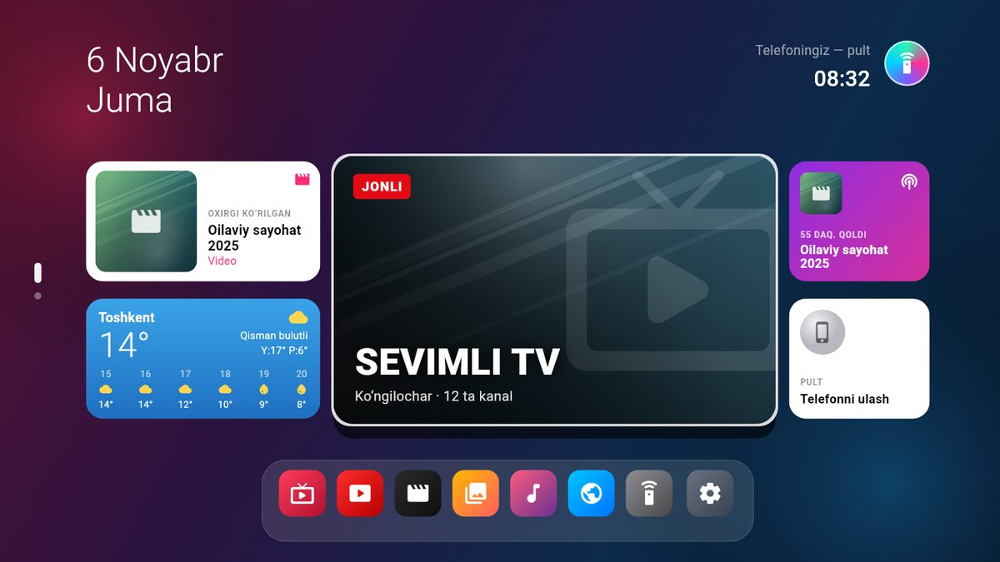
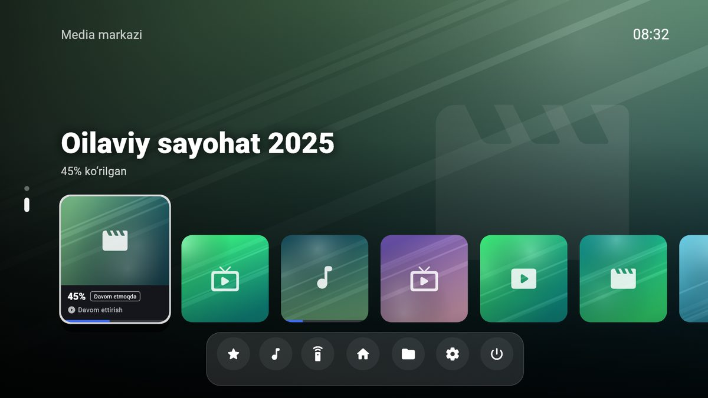
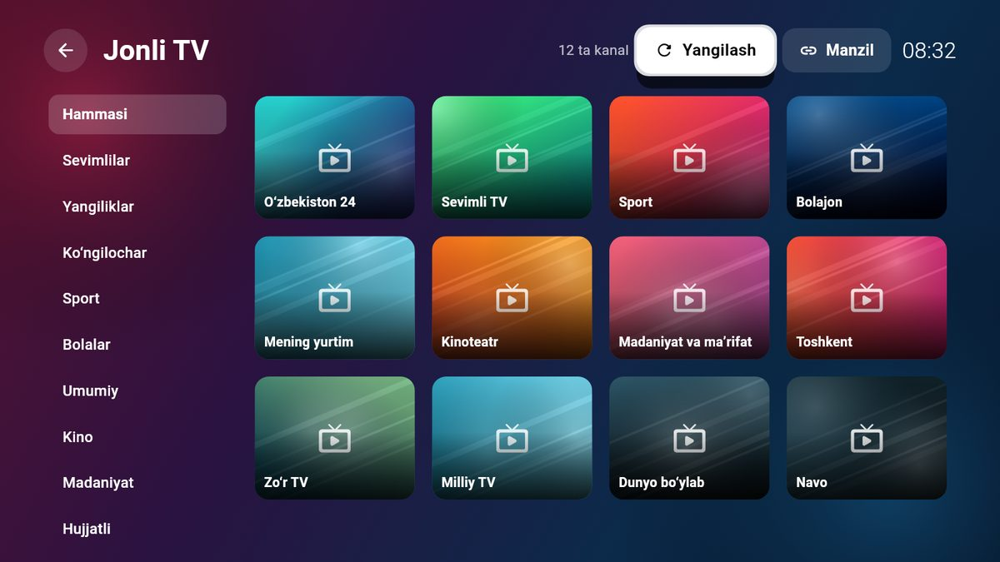
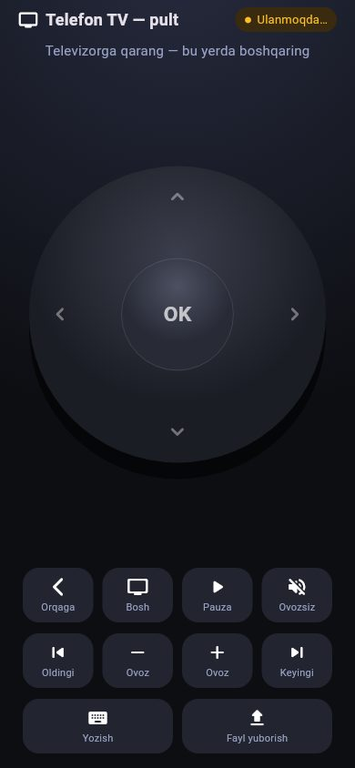

# Telefon TV

Telefon (iPhone yoki Android) bitta sim bilan oddiy televizorga ulanadi va
televizor to‘laqonli Smart TV ga aylanadi: jonli kanallar, YouTube, telefondagi
filmlar, musiqa va rasmlar, ob-havo, uyqu rejimi. Telefonning o‘z ekrani esa
shu vaqtda **pult** bo‘ladi.

<p>


</p>
<p>


</p>

## Ovoz va o‘zbekcha yordamchi

Pult bilan tanlangan ovoz darajasi va ovozsiz rejim qurilmada saqlanadi.
Kanal almashtirish, menyuga qaytish yoki ilovani qayta ishga tushirish ovozni
100 foizga qaytarmaydi. Ovozsiz rejim o‘chirilganda avvalgi daraja tiklanadi.

Yordamchi odatda o‘zbekcha javob beradi, lotin va kirill yozuvidagi buyruqlarni
qabul qiladi. Javob tili: Sozlamalar → AI yordamchi → Javob tili.
Salomlashish, yordam va asosiy boshqaruv buyruqlari internetsiz ishlaydi.
Murakkab savollarning sifati tanlangan AI modeliga bog‘liq. O‘zbekcha javoblar
Microsoft Read Aloud orqali **MadinaNeural** yoki **SardorNeural** bulutli
ovozida o‘qiladi: API kaliti va katta model yuklash talab qilinmaydi. Ovoz tanlash
va tinglab ko‘rish: Sozlamalar → AI yordamchi. Xizmat mustaqil onlayn xizmat;
uning mavjudligi va limitlari o‘zgarishi mumkin. Ulanmasa, qurilma ovozi ishlatiladi.
TV, video, brauzer va AI bir xil saqlangan ovoz foizini ishlatadi.

### Internetsiz o‘zbekcha nutq (telefonda)

Telefon pultida o‘zbekcha gapirilganini telefonning o‘zi, internetsiz taniydi.
Ikki model bor — bittasini yoki ikkalasini yuklab, tanlash mumkin:

| Model | Hajm | Xato (FLEURS) | CI sinovi* | Kimga |
|---|---|---|---|---|
| **Aniq** — NVIDIA FastConformer (115M) | 174 MB | ~11% | 39/44 so‘z (89%), 28 s ovoz 0,6 s da | o‘rtacha va kuchli telefonlar |
| **Yengil** — Vosk Zipformer2 (Alpha Cephei, oqimli) | 94 MB | ~18% | 36/44 so‘z (82%), 28 s ovoz 1,1 s da | joyi yoki xotirasi kam telefonlar |

\* 10 ta o‘zbekcha buyruq (Madina va Sardor ovozlari), ilovaning o‘z yuklash
kodi va sherpa-onnx sozlamasi bilan, GitHub Actions protsessorida.

Taqqoslash uchun: Whisper large-v3 o‘zbekchada 100% dan ortiq xato qiladi.
Modellar ilovaga qo‘shilmagan — bir marta yuklanadi: pultdagi 🎤 ni
**bosib turing** → “Internetsiz o‘zbekcha nutq” → **Yuklab olish** (Wi-Fi
tavsiya etiladi; uzilsa, qolgan joyidan davom etadi). O‘rnatilgan modelni bosib
tanlanadi, o‘chirish ham shu yerda. Birinchi marta o‘zbekcha gapirganda ham
taklif qilinadi. Gap tugaganini o‘zi sezadi (~1 soniya jimlik), aytilayotgan
so‘zlar ekranda ko‘rinib boradi. Rus va ingliz tili — telefon tizimi orqali.
Ikkala model GitHub Actions’da (build → `stt_check`) haqiqiy o‘zbekcha jumlalarda
tekshiriladi. Litsenziyalar:
[third_party/stt_uz_fastconformer/NOTICE](third_party/stt_uz_fastconformer/NOTICE),
[third_party/stt_uz_vosk/NOTICE](third_party/stt_uz_vosk/NOTICE).

### Internet qidiruvi

Bepul (kalitsiz, GPT nano), Groq va boshqa AI xizmatlari dolzarb savollarda
(yangilik, narx, kurs, o‘yin natijasi…) avval internetdan qidiradi
(DuckDuckGo, kalitsiz) va javobni topilgan ma’lumotga tayanib beradi. Gemini’da
Google qidiruvi ishlaydi. She’r, ertak, tarjima kabi ishlarda va ochiq sahifa
haqidagi savolda qidirilmaydi. O‘chirish: Sozlamalar → AI yordamchi →
Internet qidiruvi bilan javob.

Pult klaviaturasida yozilgan (yoki klaviatura mikrofoni bilan aytilgan) matn
YouTube TV qidiruviga tushadi; pultdagi asosiy mikrofon esa yordamchiga buyruq
beradi. O‘zbek kirill matni lotinga o‘tkaziladi
(Sozlamalar → AI yordamchi → YouTube qidiruvi). O‘zbekcha nutqni tanish qurilmada
mavjud bo‘lmasa, klaviaturadagi mikrofon yoki oddiy yozish ishlatiladi. LAN HTTP
orqali ochilgan web pultda brauzer mikrofoni cheklangan bo‘lishi mumkin; bu holatda
klaviaturadagi mikrofon ochiq qoladi.

## Fon va interfeys

Yandex Background Gallery’dan 2560 pikselgacha tabiat rasmlari olinadi. Fon odatda
har 60 soniyada almashadi, xiralik 50%. Sozlamalarda fonni o‘chirish, almashish
vaqti va xiralikni o‘zgartirish mumkin. Oxirgi ikki rasm keshda qoladi;
video ustida yashiringan oynalar yangi fon yuklamaydi. Katta kartalarda rasmlar,
kichik boshqaruvlarda ikonlar ishlatiladi. Ovoz va xiralik slayderlari pultning
chap/o‘ng tugmalari bilan ham boshqariladi.

Bulutli ovoz protokoli haqidagi litsenziya va manba: [third_party/edge_tts/NOTICE](third_party/edge_tts/NOTICE).

## Qanday ishlaydi

Televizor ulanganda ilova **ikkita alohida ekran** ochadi:

| Qayerda | Nima ko‘rinadi |
|---|---|
| Televizor | Smart TV: bosh ekran, kanallar, pleyer |
| Telefon | Pult: sensorli panel, tugmalar, klaviatura, fayl yuborish |

Bu oddiy ekran takrorlash (mirror) emas: televizorda alohida interfeys
chiziladi (Android — `Presentation`, iPhone — tashqi `UIScreen`).

## Ulash — bitta sim

Jonli rasm (kanallar, YouTube, telefon pulti) uchun sim **telefonning USB
uyasidan** televizorning **HDMI** uyasiga ulanadi:

| Telefon | Sim |
|---|---|
| iPhone 15 va yangilari (USB-C) | USB-C → HDMI kabel |
| iPhone 5 – 14 (Lightning) | Apple Lightning Digital AV Adapter + HDMI kabel |
| Android (USB-C, DisplayPort qo‘llaydigan: Samsung Galaxy S/Note/Tab va b.) | USB-C → HDMI kabel |
| Kabelsiz | AirPlay (iPhone) yoki Miracast / Smart View (Android) — ham alohida ekran bo‘ladi |

Televizor pultida **SOURCE / INPUT → HDMI** ni tanlang (Samsung, Artel, Yasin,
LG va boshqalar — HDMI uyasi bor istalgan televizor).

## Mac orqali (HDMI) — yengil variant

```
iPhone ──zaryad simi (USB)──► Mac ──HDMI / USB-C → HDMI──► televizor (Yasin va h.k.)
```

- **Yengil:** video, jonli kanallar (HLS) va musiqa macOS’ning o‘z
  AVFoundation’i orqali — qo‘shimcha kutubxona o‘rnatilmaydi, Mac’ning
  apparat dekoderi ishlaydi, batareya kam sarflanadi. Universal ilova: Apple
  Silicon (M1…M4) va Intel Mac, macOS 10.15 Catalina va yangisi.
- **Televizor ulanganda** Telefon TV o‘sha ekranni to‘liq egallaydi, Mac
  ekrani bo‘sh qoladi; HDMI uzilsa — oddiy oynaga qaytadi. Ilova ochiq ekan
  ekran o‘chmaydi, qulflanmaydi, ekran saqlovchi chiqmaydi, Mac uxlamaydi.
  Qo‘lda tanlash: `TELEFON_TV_SCREEN=1`.
- **Birinchi ochish (Catalina va yangilari):** DMG’dan “Programmalar”ga
  torting, keyin Finder’da “Telefon TV” ustida **Control + bosish → Open → Open**.
  Ilova App Store’dan emas, shuning uchun macOS faqat bir marta so‘raydi;
  keyin Launchpad’dan oddiy ochiladi. “Shikastlangan” desa — Terminal’da bir
  marta: `xattr -cr "/Applications/Telefon TV.app"`.
- **Ulash:** HDMI uyasi bor Mac (MacBook Pro 2021+, Mac mini, Mac Studio) —
  oddiy HDMI kabel; boshqalari — USB-C → HDMI kabel; eski Mac — Mini
  DisplayPort → HDMI.
- **iPhone — pult, USB kabel orqali:** iPhone’ni Mac’ga ulang → “Ishonish” →
  Sozlamalar → **Modem rejimi**. macOS buni o‘zi taniydi, qo‘shimcha dastur
  kerak emas. Telefon TV → **Pult** → “iPhone (USB / modem)” QR kodi →
  iPhone kamerasi → Safari’da pult. Yuborilgan videolar `Filmlar/Telefon TV`
  (`~/Movies/Telefon TV`) ga tushadi va televizorda ochiladi. (Android
  telefonni Mac’ga Wi-Fi orqali ulang: macOS Android’ning USB modemini
  tanimaydi.)
- **Ovoz televizordan:** Tizim sozlamalari → Ovoz → Chiqish → televizor.

**O‘rnatish:** [Releases](https://github.com/z3wax/phtv/releases/latest) →
`TelefonTV-…-macos.dmg` → oching → “Telefon TV” ni **Applications** ga
torting. Ilova Apple tomonidan tasdiqlanmagan (notarizatsiyasiz), shuning
uchun birinchi ochishda: Tizim sozlamalari → Maxfiylik va xavfsizlik →
**“Baribir ochish”**. Yoki Terminal’da:

```bash
xattr -cr "/Applications/Telefon TV.app"
```

Tarmoq so‘rovlari chiqsa (“kiruvchi ulanishlarga ruxsat”, “lokal tarmoq”) —
**Ruxsat berish**: pult shu orqali ulanadi.

**Fonda ishlash** (Mac yoqilganda yashirin ishga tushadi, televizor
ulanganda o‘zi paydo bo‘ladi):

```bash
mkdir -p ~/Library/LaunchAgents && printf '%s\n' '<?xml version="1.0" encoding="UTF-8"?>' '<plist version="1.0"><dict>' '<key>Label</key><string>uz.telefontv.background</string>' '<key>ProgramArguments</key><array><string>/Applications/Telefon TV.app/Contents/MacOS/Telefon TV</string><string>--background</string></array>' '<key>RunAtLoad</key><true/>' '</dict></plist>' > ~/Library/LaunchAgents/uz.telefontv.background.plist
```

```bash
launchctl load ~/Library/LaunchAgents/uz.telefontv.background.plist
```

O‘chirish: `launchctl unload ~/Library/LaunchAgents/uz.telefontv.background.plist`.

## Ubuntu kompyuter orqali (HDMI) — telefon USB kabel bilan

Telefonda HDMI adapter bo‘lmasa, eng qulay yo‘l: **kompyuter HDMI orqali
televizorga, telefon esa oddiy zaryad simi bilan kompyuterga** ulanadi.

```
telefon ──USB kabel──► Ubuntu kompyuter ──HDMI kabel──► televizor (Yasin va h.k.)
```

- Kompyuterda Telefon TV televizor ekranida to‘liq ochiladi (jismonan eng
  katta monitor; qo‘lda: `TELEFON_TV_MONITOR=1`), noutbuk ekrani bo‘sh qoladi —
  kompyuterda ishlashda davom etish mumkin.
- Video, jonli kanallar (IPTV/HLS), musiqa — mpv orqali; ovoz qurilmasi
  topilmasa video to‘xtamaydi. Ovoz televizordan chiqishi uchun Ubuntu
  Sozlamalar → Ovoz → Chiqish → HDMI ni tanlang.
- **Telefon — pult, USB kabel orqali** (Wi-Fi shart emas):
  - Android: telefonni kabel bilan ulang → Sozlamalar → Hotspot / Modem →
    **USB modem** ni yoqing.
  - iPhone: kabel bilan ulang → Sozlamalar → **Modem rejimi** ni yoqing.
  - Televizorda “Pult” bo‘limida **USB kabel** manzili va QR kod chiqadi →
    telefon kamerasi bilan skanerlang → brauzerda pult ochiladi.
- **iPhone → Ubuntu, USB kabel orqali — qadamma-qadam:**
  1. Ubuntu’da (bir marta): `sudo apt install usbmuxd libimobiledevice-utils`
     (odatda o‘rnatilgan bo‘ladi).
  2. iPhone’ni zaryad simi bilan kompyuterga ulang, iPhone’da **“Bu
     kompyuterga ishonish”** → parol.
  3. iPhone: Sozlamalar → **Modem rejimi** → “Boshqalarga ruxsat” ni yoqing
     (sim karta va operator bu rejimni qo‘llashi kerak).
  4. Ubuntu’da yangi simli ulanish paydo bo‘ladi (iPhone USB, manzil
     `172.20.10.x`). Telefon TV → **Pult** bo‘limida **“iPhone (USB / modem)”**
     tugmasi va QR kod chiqadi.
  5. iPhone kamerasi bilan QR kodni skanerlang → Safari’da pult ochiladi.
  6. Kompyuter iPhone’ning mobil internetini sarflamasligi uchun (kompyuterda
     o‘z Wi-Fi / LAN bo‘lsa): Ubuntu Sozlamalar → Tarmoq → iPhone ulanishi →
     IPv4 → **“Bu ulanishni faqat o‘z tarmog‘idagi resurslar uchun
     ishlatish”**. Yoki:
     `nmcli -t -f NAME,DEVICE connection show --active` bilan iPhone ulanishi
     nomini toping va
     `nmcli connection modify "<nomi>" ipv4.never-default yes`.
  7. Ulanmasa: brandmauer yoqilgan bo‘lsa `sudo ufw allow 8765/tcp`.
- **Telefondan video / rasm yuborish:** pultdagi “Telefondan video / rasm /
  musiqa yuborish” — fayl USB kabel orqali kompyuterning
  `Videolar/Telefon TV` papkasiga keladi va televizorda darhol ochiladi.
- **Fonda ishlash:** `./install.sh --autostart` — kompyuter yoqilganda Telefon
  TV yashirin ishga tushadi (pult serveri ishlab turadi), HDMI ulanganda
  televizorda o‘zi paydo bo‘ladi, uzilganda yashirinadi. Televizorda
  ko‘rsatayotganda ekran o‘chmaydi va kompyuter uxlamaydi.

O‘rnatish ([Releases](https://github.com/z3wax/phtv/releases/latest) →
`TelefonTV-…-ubuntu-24.04.tar.gz` yoki `-22.04`):

```bash
sudo apt install libmpv2 libwebkit2gtk-4.1-0 gstreamer1.0-libav gstreamer1.0-plugins-good gstreamer1.0-plugins-bad
```

```bash
tar xzf TelefonTV-*-ubuntu-24.04.tar.gz && cd TelefonTV-*-ubuntu-24.04 && ./install.sh --autostart
```

Ubuntu 22.04 da `libmpv2` o‘rniga `libmpv1`. O‘chirish: `./install.sh --remove`.

## USB orqali (Yasin va boshqa oddiy televizorlar)

Televizorning USB uyasi faqat fleshkadagi fayllarni o‘qiydi — jonli rasm
qabul qilmaydi (bu televizor ichidagi mikrosxemaning cheklovi, uni hech qanday
ilova o‘zgartira olmaydi). Shuning uchun USB orqali ikki yo‘l bor:

**1. Fleshka — har qanday televizor, oddiy Yasin ham.** Dokdagi **USB**
(yoki telefon pultidagi “USB fleshka”):

1. Telefondagi video, rasm, musiqani tanlang.
2. Fleshkani telefonga ulang (Android — OTG adapter; iPhone 15+ — USB-C;
   iPhone 5–14 — Lightning → USB Camera Adapter) va tanlang.
3. “Fleshkaga yozish”: fayllar `TELEFON_TV/VIDEO`, `FOTO`, `MUSIQA` ga
   yoziladi. iPhone’ning HEVC videolari va HEIC rasmlari, Android’ning HEVC
   videolari televizor o‘qiydigan **H.264 MP4** va **JPEG** ga avtomatik
   o‘tkaziladi; nomlar lotin harflariga keltiriladi.
4. Fleshkani televizorning USB uyasiga ulang. Yasin: pultda **SOURCE** (yoki
   INPUT) → **USB / Media** → `TELEFON_TV`.

Ilovada televizor turini tanlaysiz:

| Televizor | Video | Rasm |
|---|---|---|
| **Yasin LED-32E58TS** (32″, Smart emas, MStar plata, HDMI bor) | H.264, 720p gacha, MP4 | JPEG, 1920 gacha |
| Boshqa Full HD televizor | H.264, 1080p gacha, MP4 | JPEG, 3840 gacha |

Mos kelmagan video (HEVC, 4K, 60 fps 1080p dan katta, .mov/.mkv) shu shaklga
o‘tkaziladi, mosi o‘zgarishsiz nusxalanadi. Musiqa uchun MP3 eng ishonchli.
Fleshka **FAT32** bo‘lsin: oddiy televizorlar uni eng ishonchli o‘qiydi
(exFAT ni ko‘pi o‘qimaydi, telefon esa NTFS ga yoza olmaydi); FAT32 ga 4 GB
dan katta fayl sig‘maydi — ilova ogohlantiradi.

> **Yasin LED-32E58TS** Smart emas, lekin orqasida **HDMI** uyasi bor. Jonli
> kanallar, YouTube va telefon pulti bilan to‘liq Smart TV uchun — USB-C →
> HDMI (iPhone 15+, Android) yoki Lightning → HDMI (iPhone 5–14) sim; pultda
> SOURCE → HDMI. USB uyasi — fleshkadagi fayllar uchun.

**2. Telefonsiz doimiy Smart TV — Android TV stik / qutisi.**
Yasin LED-32E58TS ichida ilova ishlatadigan protsessor yo‘q, uni o‘zini
Smart qilib bo‘lmaydi. Doimiy Smart TV uchun arzon Android TV stik yoki
qutisi televizorning **HDMI** uyasiga ulanadi, quvvati televizorning **USB**
uyasidan olinadi (stik 1 A dan ko‘p so‘rasa — o‘z adapteri bilan). Telefon TV
stikka o‘rnatiladi:

1. Android telefonda USB → “Ilovani fleshkaga yozish”.
2. Fleshkani stik / qutiga ulang (stikka OTG adapter bilan) → Fayl menejeri →
   `TELEFON_TV/TelefonTV.apk` → O‘rnatish.
3. Telefon TV → Sozlamalar → **“Yoqilganda Telefon TV ochilsin”**: ilova
   bosh ekran (launcher) bo‘ladi — televizor yoqilganda darhol Smart TV
   ochiladi, Home tugmasi bosh sahifaga qaytaradi, dokdagi **Ilovalar**
   stikdagi barcha ilovalarni (YouTube, brauzer, kinoteatrlar) ko‘rsatadi.
4. Stik pulti ishlaydi; telefoningiz QR kod orqali qo‘shimcha pult bo‘ladi.

Android TV li Smart televizorlarga ham xuddi shunday o‘rnatiladi. Google TV
ning yangi versiyalari boshqa bosh ekranni cheklashi mumkin — oddiy Android
TV qutilarida ishlaydi.

### Adapter yo‘q bo‘lsa (Lightning’li iPhone)

- Oddiy zaryad simi bilan televizorning USB uyasiga ulangan iPhone faqat
  zaryadlanadi: jonli rasm uchun simning ichida mikrosxema bo‘lishi kerak
  (Apple Lightning Digital AV Adapter shuning uchun bor). Buni ilova aylanib
  o‘ta olmaydi.
- **Sinab ko‘ring:** iPhone’ni zaryad simi bilan Yasin’ning USB uyasiga ulang →
  iPhone’da “Ishonish” → pultda SOURCE → USB. Rasm va videolar chiqsa, ular shu
  sim orqali ochiladi (televizor iPhone’ni “kamera” sifatida o‘qiydi).
- **Jonli Smart TV uchun eng arzon yo‘l — simsiz HDMI dongle** (AirPlay /
  Miracast qabul qiluvchi): HDMI ga ulanadi, quvvatini televizorning USB
  uyasidan oladi; iPhone’da Boshqaruv markazi → “Ekranni takrorlash”. Telefon
  TV buni alohida ekran sifatida ishlatadi: televizorda Smart TV, telefonda
  pult.

Samsung telefonlar HDMI ulanganda DeX rejimini ochishi mumkin: bildirishnomadan
“Ekranni ko‘chirish (Screen mirroring)” ni tanlang yoki DeX’ni o‘chiring.

## Pult

- **Telefonning o‘zi** — Apple TV pultidagidek dumaloq panel: surish — yo‘nalish,
  o‘rtasi — OK; Orqaga, Bosh sahifa, Pauza, Ovoz, Oldingi/Keyingi, Yozish,
  Fayl yuborish.
- **Ikkinchi telefon** — televizorda *Pult* bo‘limidagi QR kodni skanerlang:
  brauzerda pult ochiladi, ilova shart emas (bitta Wi-Fi, hotspot yoki USB
  kabel, PIN bilan).
- **Telefon TV ilovasi — pult rejimi** (brauzer pultidagi hamma imkoniyat):
  ilova ochilganda **“Pult”** ni tanlang → **QR kodni skanerlash** → televizordagi
  QR kod. Sensorli panel, Orqaga / Bosh / Pauza / Ovoz / Oldingi / Keyingi,
  doim ko‘rinadigan matn maydoni (televizor matn so‘rasa — o‘zi to‘ladi),
  **telefondan video / rasm / musiqa yuborish** foiz ko‘rsatkichi bilan. Oxirgi
  televizor eslab qolinadi — keyingi safar ilova o‘zi ulanadi.
- **Bluetooth pult, klaviatura yoki o‘yin pulti** — telefonga ulang, darhol ishlaydi
  (strelkalar, OK/Enter, Orqaga/Esc, Play/Pause, kanal ±).
- Televizorning o‘z infraqizil pulti telefonga signal yubora olmaydi.

## Imkoniyatlar

- **Bosh ekran** (Apple TV uslubi): sana va soat, oxirgi ko‘rilgan, ob-havo
  (Open-Meteo, 13 ta shahar), tavsiya etilgan kanal, davom ettirish, pultlar, dok.
- **Media markazi** (PlayStation uslubi): katta fon, kartalar qatori, ko‘rilgan
  foiz, pastki menyu.
- **Ochilish**: televizordagidek “z3wax tv” yuklanish ekrani — ekran nur
  chizig‘i bo‘lib yonadi, belgi paydo bo‘ladi, yuklanish chizig‘i to‘ladi.
  Tizim yoqilganda, televizor ulanganda, uyqudan uyg‘onganda va telefon
  ilovasi ochilganda chiqadi (telefonda bosilsa — o‘tkazib yuboriladi).
  Ekranlar orasida silliq o‘tish, fonda suzuvchi yorug‘liklar.
- **AI yordamchi (ovozli)**: pultdagi 🎤 tugmasini bosib gapiring —
  “YouTube’da multfilm qo‘y”, “Sevimli TV ni qo‘y”, “ovozni ko‘tar”,
  “ob-havo qanday”, “ivi’ni och”, istalgan savol. Oddiy buyruqlar internetsiz,
  darhol; savollar — **bepul AI**: kalitsiz (darrov) yoki Google Gemini /
  Groq’ning bepul kaliti (Sozlamalar → AI yordamchi). Javob ekranda va ovozda.
- **Jonli TV**: 1000+ ochiq kanal to‘plamlari — O‘zbekiston, kino, seriallar,
  bolalar, multfilmlar, sport, musiqa, hujjatli, rus, turk, qozoq tilida;
  HD / FHD / 4K belgisi, “Faqat HD” filtri, sifatlisi tepada. Manba ishlamasa
  yoki qotib qolsa — pleyer o‘zi shu kanalning boshqa manbasiga o‘tadi.
- **Radio**: O‘zbekiston, rus, turk, qozoq va dunyo radiolari (Radio Browser),
  qidiruv; fayl so‘ramaydi.
- **Kino saytlari**: ivi, Uzmovi, iDub (asl sayt — idub.tv),
  Kinopoisk, Okko, MEGOGO, iTV, Netflix va o‘zingiz qo‘shgan saytlar.
- **Video pleyer**: kompyuterdagi fayl, telefondan yuborish, havola (mp4, m3u8).
- **Pleyer**: video, HLS jonli efir, musiqa, rasmlar va slayd-shou; to‘xtagan
  joyidan davom etadi.
- **Fayllar**: telefondagi video, musiqa va rasmlar televizorda.
- **YouTube**: kompyuter sayti emas, aynan televizor ko‘rinishi
  (youtube.com/tv) ochiladi — ↑↓←→ va OK bilan yuriladi, Orqaga — bir
  qadam ortga, tez ikki marta — chiqish. YouTube havolalari ham (masalan,
  youtube.com/watch, youtu.be) shu ko‘rinishda ochiladi.
- **Kino saytlari va brauzer**: Android, iPhone, Mac va Ubuntu’da ilovaning
  o‘z brauzerida. Sichqoncha kursori yo‘q — televizordagidek odatiy tanlash:
  ↑↓←→ — keyingi havola yoki tugma ajratiladi (kerak bo‘lsa sahifa
  suriladi), OK — bosish, Orqaga — oldingi sahifa; matn maydonida OK —
  pultda yozish (**Bo‘sh joy (Space)** tugmasi bilan). Ubuntu’da WebKitGTK
  va GStreamer ishlaydi.
- **AI brauzer**: “Qisqacha” — AI sahifani tushuntiradi, “Savol” — sahifa
  haqida so‘rash.
- **Pult**: Apple TV pulti shaklida, to‘liq qora — ilovada ham, brauzerda ham.
  Telefonning ovoz tugmalari televizor ovozini boshqaradi.
- **Sozlamalar**: ob-havo shahri, ekran chetlari (overscan), pleylist manzili,
  pultlar, tozalash. **Uyqu rejimi** — qora ekran va xira soat; istalgan
  tugma — tizim “z3wax tv” ekrani bilan qayta yonadi.
- Interfeys 720p, 1080p va 4K televizorda bir xil ko‘rinadi.
- Login, server, reklama yo‘q — hamma narsa telefonda.

## O‘rnatish

**[Releases → eng so‘nggi versiya](https://github.com/z3wax/phtv/releases/latest)**
(login shart emas):

- `TelefonTV-….apk` — Android: telefonda yuklab oling va o‘rnating
  (so‘rasa, “noma’lum manbalar” ga ruxsat bering).
- `TelefonTV-…-imzosiz.ipa` — iPhone: imzosiz IPA, o‘z Apple ID bilan imzolab
  o‘rnatiladi (Ubuntu’da **iloader** — iloader.app, yoki Sideloadly / AltStore);
  bepul Apple ID’da 7 kunda qayta o‘rnatish kerak.
- `TelefonTV-…-macos.dmg` — Mac (yuqorida).
- `TelefonTV-…-ubuntu-24.04.tar.gz` / `-22.04` — Ubuntu kompyuter (yuqorida).

Har bir yangilanishdan keyin GitHub Actions bularni o‘zi yig‘ib, Releases’ga
qo‘yadi.

## Ishlab chiquvchilar uchun

```bash
flutter pub get
flutter analyze
flutter test
flutter run
```

- `lib/main.dart` — `main()` telefon ekrani, `tvMain()` televizor ekrani.
- `lib/tv/` — Smart TV: ekranlar, pult serveri (`server.dart`, port 8765),
  pult buyruqlari (`input.dart`), saqlash (`store.dart`).
- `lib/phone/` — telefon ekranidagi pult.
- `android/.../MainActivity.kt`, `ios/Runner/AppDelegate.swift` — televizor
  ulanganda ikkinchi Flutter dvigatelini tashqi ekranda ochadi.
